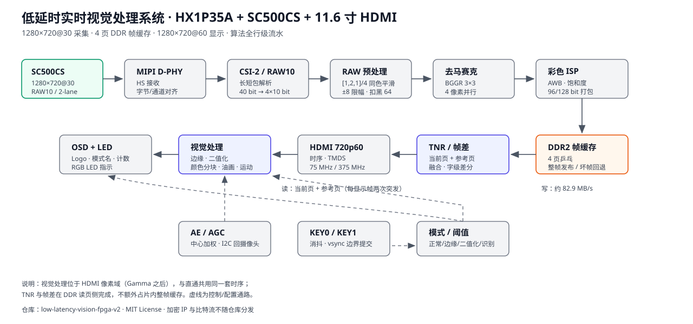

# Low-Latency Real-Time Vision on Anlogic PH1P35 (v2)

[简体中文](README.md) | English

A low-latency vision platform running on the **Anlogic PH1P35MDG324** (HX1P35A board):

**SC500CS camera capture → MIPI RAW preprocessing → color ISP → 4-page DDR frame buffer → HDMI 720p60 display**,
with **edge detection, adaptive binarization, color detection and color-block tracking, video oil-paint,
and frame-difference motion detection** performed in the display pixel domain.

- Capture: SC500CS, 1280×720@30, 2-lane MIPI RAW10
- Display: HDMI 1.4, 1280×720@60 (11.6-inch panel)
- Modes: normal color / edge / binary / color detection, with oil-paint and motion sub-modes
- Storage: 4-page DDR frame buffer; algorithms use line buffers only, no full-frame on-chip buffer
- Latency: about 2 camera frames + tens of lines, fully line-pipelined
- Interaction: KEY0 cycles main modes, KEY1 cycles sub-modes, switching is committed at vsync; RGB LED indicates detected colors



## Modes and keys

| Main mode | KEY0 | KEY1 sub-mode |
|---|---|---|
| 0 · Normal color | original color image | original ↔ **oil paint** |
| 1 · Edge | Canny-variant edges (white on black) | — |
| 2 · Binary | frame-level adaptive threshold | — |
| 3 · Color detection | red/green/blue boxes | **color blocks** ↔ **frame-difference motion** |

Edge threshold is fixed at 100 and binary threshold at 128 in `rtl/top/design_top_wrapper.v`.
The RGB LED (J1-2/3/4, V1/U2/U1) lights up for detected red/green/blue targets.
KEY2/KEY3 are reserved and not assigned in `constraints/pin.adc`.

## Repository layout

| Path | Content |
|---|---|
| `rtl/top/` | Top-level wiring, clocks, keys, LED, OSD/HDMI output |
| `rtl/capture/` | MIPI CSI-2 unpack, RAW10 unpack, AXI4-Stream shaping |
| `rtl/isp/` | Demosaic, AWB, saturation, gamma, RAW filter/black level, packing |
| `rtl/vision/` | Edge, binary, color blocks, oil paint, motion OSD, mode control |
| `rtl/video/` | Frame-buffer read/write, page tracking, DDR user interface |
| `rtl/display/` | HDMI timing, mixer, TMDS wrapper, LVDS serializer |
| `rtl/control/` | AE/AGC loop, key debounce |
| `rtl/drivers/sc500/` | SC500CS register tables and I2C |
| `rtl/osd/` | Anlogic logo overlay (bitmap ROM not included) |
| `rtl/vendor/` | Notes for vendor encrypted/generated IP (not distributed) |
| `constraints/` | `pin.adc`, `camera_to_dsi_display.sdc` |
| `scripts/` | TD synthesis/place/bitgen templates and GitHub publish script |
| `tests/` | Python static checks and behavioral models |
| `docs/` | Data path, algorithms, core code, tuning, resources and limits |
| `hardware/`, `assets/` | Board/camera/wiring and bitmap/font notes |

## Quick start

1. Install Anlogic Tang Dynasty (TD) 6.2 and the device library;
2. Create a project for `PH1P35MDG324`, speed grade `-3`;
3. Add all `.v` files under `rtl/` (read `rtl/vendor/README.md` first and supply the missing vendor IP);
4. Add `constraints/pin.adc` and `constraints/camera_to_dsi_display.sdc`; use the templates in `scripts/`;
5. Generate the bitstream and program the board;
6. Press KEY0 to cycle modes, KEY1 for oil paint or motion detection.

Vendor IP that is **not** included: MIPI D-PHY RX, DDR2 controller/PHY, HDMI 1.4 TMDS core,
PLL, asynchronous FIFOs, block RAM, 48-bit pipelined divider, and the Anlogic logo ROM.
See `rtl/vendor/README.md` for parameters and replacement instructions.

## Tests

```powershell
python -m unittest discover -s tests -v
```

Covers repository layout, key/LED pin mapping, mode mapping, and behavioral models for
oil paint, frame-difference motion, and color detection. These checks do not replace on-board
observation; color thresholds and exposure still need to be confirmed under real lighting.

## Known limitations

- At most 2 boxes per color (green keeps 1); same-color targets may be merged or missed;
- Color detection draws boxes only, no shape classification (`O_shape` is fixed to `12'hfff`);
- Motion detection works on 16-byte words; very small or textureless motion may be missed;
- The center counter requires the target to cover (640, 360) and to leave the center for 4 frames before counting again;
- Oil paint outputs 4 bit per channel; TNR may leave slight ghosting on fast motion;
- Only KEY0/KEY1 are connected; external actuators are not wired (RGB LED is the only output);
- Encrypted vendor IP and bitstreams are not redistributed.

## Version and license

- v1 (Gitee): <https://gitee.com/tin-mng-chn-bng/low-latency-vision-fpga>
- v2 (this repository): improved8 feature set, see the Chinese `README.md` for details
- Own RTL, Python scripts and documentation are released under the [MIT License](LICENSE);
- Vendor IP and trademarks remain the property of their respective owners.
