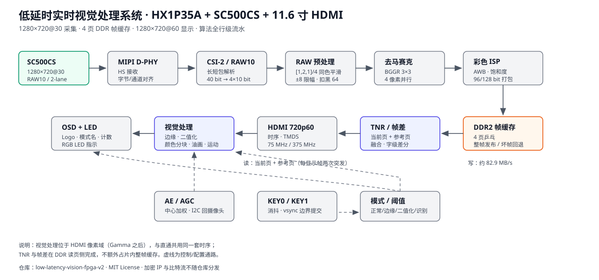

# 低延时实时视觉处理系统 v2 · Low-Latency Real-Time Vision on Anlogic PH1P35

> 2026 年全国大学生嵌入式芯片与系统设计竞赛 · FPGA 创新设计赛道 · 选题二
> “基于安路 FPGA 的实时数字图像处理系统”的开源实现

一套跑在安路 **HX1P35A** 开发板（PH1P35MDG324）上的低延时视觉平台：

**SC500CS 摄像头采集 → MIPI RAW 预处理 → 彩色 ISP → 4 页 DDR 帧缓存 → HDMI 720p60 显示**，
在显示像素域完成 **边缘检测、二值化、色彩识别与色彩分块、视频油画、帧差运动检测**，
并用 **KEY0 / KEY1** 在帧边界平滑切换模式，用板载 **RGB LED** 指示识别结果。

- 采集：SC500CS，1280×720@30，2-lane MIPI RAW10
- 显示：HDMI 1.4，1280×720@60，11.6 寸显示屏
- 算法：正常彩色 / 边缘检测 / 二值化 / 色彩识别（含色彩分块、帧差运动检测）/ 油画
- 存储：4 页 DDR 帧缓存；算法只用行缓冲，不做整帧缓存
- 延迟：约 2 个摄像头帧 + 数十行，算法行级流水
- 交互：KEY0 切主模式，KEY1 切子模式；切换在帧边界生效，无撕裂；RGB LED 指示颜色



> 上面这张图由 `docs/images/system_arch.svg` 提供（纯矢量、无外部依赖）。如果不想看 SVG，直接跳到[目录](#目录)与[模式](#模式与按键)。

---

## 目录

| 目录 | 内容 |
|---|---|
| `rtl/top/` | 顶层连线、时钟、按键、LED 与 OSD/HDMI 输出 |
| `rtl/capture/` | MIPI CSI-2 解包、RAW10 拆包、AXI4-Stream 整形 |
| `rtl/isp/` | 去马赛克、AWB、饱和度、Gamma、RAW 空域/扣黑、位宽打包 |
| `rtl/vision/` | 边缘、二值化、颜色分块、油画、帧差运动 OSD、模式与阈值 |
| `rtl/video/` | 帧缓存读写、页跟踪、DDR 用户接口、时域融合/帧差观测 |
| `rtl/display/` | HDMI 时序、混音、TMDS 包装、LVDS 并串 |
| `rtl/control/` | AE/AGC 闭环、按键消抖 |
| `rtl/drivers/sc500/` | SC500CS 寄存器配置与 I2C |
| `rtl/osd/` | 安路 Logo 叠加（位图 ROM 不在仓库） |
| `rtl/misc/` | VTC、I2S 接收（音频未接入） |
| `rtl/vendor/` | 原厂加密 IP 与生成文件说明（**不包含**这些文件） |
| `constraints/` | 引脚约束 `pin.adc`、时序约束 `camera_to_dsi_display.sdc` |
| `scripts/` | 安路 TD 综合/布局/比特流脚本模板 |
| `tests/` | Python 静态检查与逐像素行为模型（可单独运行） |
| `docs/` | 总览、算法、核心代码、调参、验证与限制 |
| `hardware/` | 开发板、摄像头、接线、按键与时钟 |
| `assets/` | Logo 与字模说明（原始素材不随仓库分发） |

---

## 模式与按键

主模式由 **KEY0（丝印，工程信号 `I_key1`，管脚 D5）** 循环切换，子模式由 **KEY1（`I_key2`，A9）** 切换：

| 主模式 | KEY0 切换后的画面 | KEY1 子模式 |
|---|---|---|
| 0 · 正常彩色 | 原始彩色画面 | 原图 ↔ **油画** |
| 1 · 边缘检测 | Canny 变体边缘（黑底白线） | 无 |
| 2 · 二值化 | 帧级自适应阈值黑白图 | 无 |
| 3 · 色彩识别 | 红/绿/蓝分块框选 | **色彩分块** ↔ **帧差运动检测** |

- 阈值：边缘固定 `100`、二值化固定 `128`，在 `rtl/top/design_top_wrapper.v` 中作为常量给出，改完重新综合；
- 所有模式切换都在 `vsync` 上升沿提交，切换不撕裂；
- 色彩识别模式下，识别到红/绿/蓝会点亮 J1 排针上的对应 LED（V1/U2/U1，J1-12 为 GND）；
- KEY2、KEY3 在本工程中未分配管脚（`pin.adc` 只定义 KEY0/KEY1），属于预留。

---

## 快速开始

### 硬件

- 安路 HX1P35A 开发板（PH1P35MDG324，38184 LUT、42432 DFF、108 块 RAM、40 DSP）
- Smartsens SC500CS 摄像头（2-lane MIPI，RAW10，1280×720@30）
- 11.6 寸 HDMI 显示屏（1280×720@60）
- 下载器：板载 AL-LINK

接线、按键、LED 与时钟说明见 [`hardware/README.md`](hardware/README.md)。

### 软件

1. 安装安路 Tang Dynasty（TD）6.2 与器件库；
2. 新建工程，器件选 `PH1P35MDG324`、速度等级 `-3`；
3. 把 `rtl/` 下所有 `.v` 加入源文件（先读 [`rtl/vendor/README.md`](rtl/vendor/README.md)，补齐不在仓库里的 IP）；
4. 加入 `constraints/pin.adc` 与 `constraints/camera_to_dsi_display.sdc`，综合/布局模板见 `scripts/`；
5. 生成比特流并烧录；
6. 上电后按 KEY0 切换：正常彩色 → 边缘 → 二值化 → 色彩识别；在正常彩色下按 KEY1 看油画，在色彩识别下按 KEY1 看运动检测。

### 依赖的原厂 IP（不在本仓库）

本工程使用以下**加密或工具生成**的 IP，仓库不包含、也不再分发：

- MIPI D-PHY 接收（`mipi_dphy_rx` 相关 `.enc.v` / `.enc.sv`）
- DDR2 控制器与 PHY（`ph1p35_ddr`，含 `alc_mc_top_all.enc.sv`）
- HDMI 1.4 TMDS 发送核（`hdmi_1_4b_transmitter_core_wrapper.enc.v`）
- PLL（`PLL` / `ph1p_phy_pll_wrapper_*.v`）
- 异步 FIFO `w128_d512_fifo`、`w155_d512_fifo`
- 去马赛克行缓存 RAM（`blk_mem_gen_zhenghe` / `ram_d32970204f32`）
- 48 位流水除法器（`divider_gate.v`）
- 安路 Logo 位图 ROM（`anlogic_logo_rom.v`，来自赛题例程）

获取方式与重新生成参数见 [`rtl/vendor/README.md`](rtl/vendor/README.md)。

---

## 设计要点

| 功能 | 算法/结构 | 代码位置 |
|---|---|---|
| 实时采集 | CSI-2 长短包 → RAW10 拆包 → AXI4-Stream，2-lane | `rtl/capture/` |
| RAW 预处理 | 同色三点平滑 `[1,2,1]/4`（±8 限幅）+ 固定扣黑 64 | `rtl/isp/raw_temporal_diag.v` |
| 去马赛克 | BGGR 3×3 双线性，4 像素并行 | `rtl/isp/demosaic/` |
| 自动白平衡 | 灰度世界 + Q16 比值 + 1/4 平滑，一个 48 位除法器两相串行 | `rtl/isp/awb.v` |
| 饱和度 / Gamma | BT.601 保亮度色差放大；256 项预计算 LUT | `rtl/isp/color_enhance.v`、`gamma_correction.v` |
| 自动曝光 | 中心加权测光、曝光优先、三档高亮保护 | `rtl/control/auto_exposure.v` |
| 帧缓存 | 4 页乒乓、整帧发布、坏帧回退 | `rtl/video/video_in.v` |
| 时域降噪 | 当前页 + 参考页逐 128 bit 字融合，通道差 ≤8 视为相似 | `rtl/video/video_out.v` |
| 边缘检测 | 两级 3×3 中值 → Sobel → NMS → 双阈值 → 7×7 滞后连接 → 形态学修复 | `rtl/vision/edge_detect.v` |
| 二值化 | 直方图双峰 + 迭代类均值 + IIR/死区/限幅 | `rtl/vision/auto_thresh.v`、`local_bin.v` |
| 色彩分块 | RGB 分量判决 + 行行程 + 双候选包围盒 + 平滑保持 | `rtl/vision/edge_detect.v` |
| 视频油画 | 5×5 邻域、4 个亮度桶、取最多桶的平均色，4 bit/通道 | `rtl/vision/edge_detect.v`（`oil_pixel5`） |
| 帧差运动 | 16 字节字级差分（≥6 通道变化）+ 行配对包围盒 + 中心覆盖计数 | `rtl/video/video_out.v`、`rtl/vision/osd_text.v` |
| 交互 | 4 级同步 + 长按释放消抖；vsync 边界切模式；RGB LED | `rtl/control/key_remove_shakes.v`、`rtl/vision/mode_toggle.v` |
| OSD | Logo、模式名、运动计数、中心十字、活动区着色 | `rtl/osd/`、`rtl/vision/osd_text.v` |

更细的逐级延迟、位宽与代码片段见 `docs/`。

---

## 适合怎么读

1. 先看 [`docs/01_项目总览与数据通路.md`](docs/01_项目总览与数据通路.md)，把六段数据流和时钟域对上；
2. 再看 [`docs/02_算法流水线.md`](docs/02_算法流水线.md)，按“基础 / 扩展 / 进阶”理解每一级；
3. 然后进 `rtl/vision/` 对照 [`docs/03_核心代码解读.md`](docs/03_核心代码解读.md)，看窗口、阈值、分块框、油画与帧差是怎么写出来的；
4. 想改参数、调画面，看 [`docs/04_参数与调参.md`](docs/04_参数与调参.md)；
5. 想复现资源与时序，看 [`docs/05_资源_验证与限制.md`](docs/05_资源_验证与限制.md)。

---

## 验证

`tests/` 保留可单独运行的静态检查与行为模型，不依赖 TD、ModelSim 或开发板：

```powershell
python -m unittest discover -s tests -v
```

| 脚本 | 覆盖内容 |
|---|---|
| `tests/test_repo_layout.py` | 模块闭包、文件边界（无加密/构建产物）、按键与 LED 引脚、模式映射 |
| `tests/oil_model.py` | 5×5 油画量化/桶投票/桶均值，与 RTL 的 4 bit 输出对齐 |
| `tests/motion_model.py` | 16 通道差分、≥6 票、连续支持、行配对、中心覆盖与计数 |
| `tests/color_model.py` | RGB 判决、行程/包围盒、双候选与平滑保持 |

这些脚本证明“实现与设计一致”，不替代上板观察。颜色阈值、曝光目标、油画强度仍需在真实光照下确认。

---

## 资源与限制

- 器件：38184 LUT、42432 DFF、108 块 RAM、40 个 DSP；本设计功能密度很高，具体占用以你本地 TD 报告为准；
- 帧缓存：4 页 × 172800 个 128 bit 字，每页地址步长 7,000,000；
- 带宽：写约 82.9 MB/s；显示读当前页 + 参考页约 331.8 MB/s；合计约 414.7 MB/s，约为 66 MHz × 128 bit 的 39%（以 DDR IP 实际时钟为准）；
- 已知限制：
  - 每种颜色最多 2 个框（绿色只保留 1 个），同色多目标会合并或漏掉；
  - 颜色只出框，不做形状分类（`O_shape` 固定为 `12'hfff`）；
  - 运动检测基于 16 字节字块，最小目标约 30×10 像素，细小运动可能漏检；
  - 中心计数要求目标覆盖画面中心 (640, 360)，只在运动检测子模式下工作；
  - 油画输出 4 bit/通道，细节被刻意压平；快速运动时 TNR 可能带来轻微拖影；
  - 只有 KEY0/KEY1 接入，外部执行器未接（RGB LED 是唯一输出）；
- 仓库不包含 `.bit`、TD `Runs/`、综合/布局报告、加密 IP 与生成文件，避免大文件与工具产物混进源码。

---

## 从 v1 到 v2

| 能力 | v1（Gitee） | v2（本仓库，improve8） |
|---|---|---|
| 正常彩色 / 边缘 / 二值化 / 色彩识别 | ✅ | ✅ |
| 子模式切换（KEY1） | ❌ | ✅ 原图/油画、分块/运动 |
| 视频油画 | ❌ | ✅ 5×5 四桶均值 |
| 色彩分块（双候选跟踪） | 单框 | ✅ 红/蓝各 2、绿 1 |
| 帧差运动检测 | ❌ | ✅ 字级差分 + 中心计数 + 活动区着色 |
| 时域降噪 | 旁路 | ✅ 当前页/参考页融合 |
| RGB LED 指示 | ❌ | ✅ 识别颜色点亮 |
| 按键平滑切换 | 帧边界 | ✅ 消抖 + vsync 提交 |

---

## 第三方与许可证

- 本仓库**自己编写**的 RTL、Python 脚本与文档采用 [MIT License](LICENSE)；
- 安路 D-PHY/DDR/HDMI/PLL/FIFO/除法器/RAM 等加密或生成 IP、SC500CS 寄存器配置参考、赛题例程 Logo 位图，版权归原作者/厂商所有，仓库仅保留必要的接口与说明，不包含其二进制或加密源码；
- “安路”“Anlogic”是其商标，本仓库仅用于竞赛学习与技术展示。

---

## 致谢

感谢安路科技提供的器件、IP 与工具链，以及杭州康芯电子提供的 HX1P35A 开发板与赛题资料。
