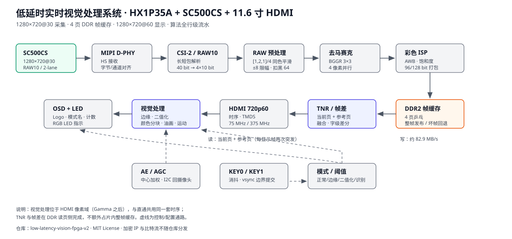

# 01 · 项目总览与数据通路

这一篇回答三个问题：**这套系统要做什么、数据怎么走、延迟花在哪里**。看完再去读 `rtl/`，就不会一上来被几十个模块淹没。

## 1. 一句话定位

在安路 PH1P35 上，把 SC500CS 的 RAW 数据变成 HDMI 上稳定、低延时、可切换算法的彩色画面，并在像素流里实时完成边缘、二值化、颜色分块、油画与帧差运动检测。

| 指标 | 数值 |
|---|---|
| 采集 | SC500CS，1280×720@30，2-lane MIPI RAW10 |
| 显示 | HDMI 1.4，1280×720@60，11.6 寸屏 |
| 主模式 | 正常彩色 / 边缘检测 / 二值化 / 色彩识别（KEY0 切换） |
| 子模式 | 正常彩色：原图 ↔ 油画；色彩识别：色彩分块 ↔ 帧差运动（KEY1 切换） |
| 算法存储 | 只用行缓冲；除 DDR 帧缓存外无整帧缓存 |
| 端到端延迟 | 约 2 个摄像头帧 + 数十行（估算，见第 6 节） |
| 交互 | KEY0/KEY1 切模式；RGB LED 指示识别颜色；全部在帧边界生效 |

## 2. 硬件与工具

| 项目 | 说明 |
|---|---|
| FPGA | 安路 PH1P35MDG324：38184 LUT、42432 DFF、108 块 RAM、40 DSP |
| 开发板 | 杭州康芯 HX1P35A（板载 AL-LINK、HDMI、MIPI FPC） |
| 摄像头 | Smartsens SC500CS，500 万像素，2-lane MIPI，RAW10 |
| 显示屏 | 11.6 寸 HDMI，1280×720@60 |
| 工具 | 安路 Tang Dynasty（TD）6.2：综合、布局布线、比特流 |
| 验证 | Python 3.10+，不需要 ModelSim 授权 |

## 3. 数据流：六段

1. **采集与解包**：D-PHY 硬核 → CSI-2 长短包 → RAW10 拆包 → AXI4-Stream（`rtl/capture/`）；
2. **RAW 预处理**：同色三点平滑 `[1,2,1]/4`（±8 限幅）+ 固定扣黑 64（`rtl/isp/raw_temporal_diag.v`）；
3. **彩色 ISP**：BGGR 3×3 双线性 → AWB → 饱和度 → 96/128 bit 打包（`rtl/isp/`）；
4. **帧缓存**：128 bit 字写入 DDR，4 页乒乓，读页 = 写页 − 2（`rtl/video/`）；
5. **显示与视觉**：HDMI 时序 → Gamma → 视觉算法 → OSD/LED（`rtl/vision/`、`rtl/display/`）；
6. **闭环控制**：AE/AGC 统计与 I2C 写寄存器；按键消抖与帧边界切换（`rtl/control/`）。

关键选择：**算法放在显示像素域**，而不是采集域。算法只面对 75 MHz、每拍一个像素的稳定流，不必处理 MIPI 突发与字节对齐；处理与直通共用同一套 HDMI 时序。

## 4. 五种画面，同一条主链

| 画面 | 选择条件 | 额外处理 | 输出 |
|---|---|---|---|
| 正常彩色 | `I_mode=0`，`I_style[0]=0` | 无（直通） | RGB888 |
| 油画 | `I_mode=0`，`I_style[0]=1` | 5×5 四桶量化均值 | 4 bit/通道扩展 |
| 边缘 | `I_mode=1` | 中值×2 → Sobel → NMS → 双阈值 → 滞后连接 | 黑底白线 |
| 二值化 | `I_mode=2` | 帧级直方图 + 迭代类均值 | 纯黑白 |
| 色彩分块 | `I_mode=3`，`I_style[1]=0` | 颜色判决 + 行程 + 双候选框 | 原图 + 彩色框/标签 |
| 帧差运动 | `I_mode=3`，`I_style[1]=1` | 当前页/参考页字级差分 + 中心计数 | 原图 + 活动区着色/计数 |

主模式和子模式都由 `mode_toggle` 维护，切换请求在 `vsync` 上升沿提交。`edge_detect` 用 `I_style[1:0]`
同时表达“油画”和“运动检测”两个子状态，避免再增加一组跨模块控制线。

## 5. 时钟域

| 时钟 | 频率 | 主要负载 | 跨域方式 |
|---|---|---|---|
| `I_sys_clk` | 50 MHz | PLL 参考、DDR 参考 | — |
| `pll_clk_100m` | 100 MHz | D-PHY 低速控制、复位 | — |
| `pll_clk_24m` | 23.81 MHz | SC500CS I2C 配置 | AE 请求保持 + 完成应答 |
| `MIPI_RX_BYTE_CLK` | 约 240 MHz DDR / 4 | CSI-2、RAW10、ISP | 写侧异步 FIFO |
| DDR `usr_clk` | 约 66 MHz | 帧缓存读写、页跟踪、TNR/帧差 | 读/写异步 FIFO |
| `HDMI_PIXEL_CLK` | 75 MHz | HDMI 时序、Gamma、视觉、OSD | 读侧异步 FIFO |
| `HDMI_SERIAL_CLK` | 375 MHz | TMDS 串行发送 | 像素域并行加载 |

## 6. 四页乒乓、TNR 与延迟

- 一帧 1280×720 RGB888 = 2 764 800 字节 = 172 800 个 128 bit 字；
- 写指针只在“帧首且没有 MIPI 误码”时前进；读指针 = 写指针 − 2（模 4）；
- 页跟踪器只在恰好写满 172 800 字时发布该页，短帧、超长帧、误码帧都不发布；
- 显示侧除了读当前页，还会读 **page+1** 作为参考页，用于时域融合和帧差；参考页不参与显示，只增加 DDR 读带宽；
- 端到端延迟 ≈ 曝光/读出（约 1 帧）+ 页调度（约 1 帧）+ 行级流水（约 10 行 + 29 拍）+ 扫描（≤1 行）。

延迟是**固定、可预测**的：换算法只改行缓冲级数，不改变“帧”的数量。TNR 与帧差都在读页侧完成，
不额外引入整帧延迟。

## 7. 四条设计约束

1. **算法只用行缓冲**：窗口运算不引入整帧缓存，统计只累加标量；
2. **统计旁路监听**：AE、阈值、颜色统计只读像素流，不回压、不改写；
3. **帧边界生效**：模式、阈值、增益、OSD 内容都在帧同步后更新；
4. **能用移位/加法则不用乘法器**：视觉相关逻辑不占 DSP。

这四条决定了后面所有模块的写法，也是这套代码能在高占用下继续迭代的原因。

下一篇：[02 · 算法流水线](02_算法流水线.md)
