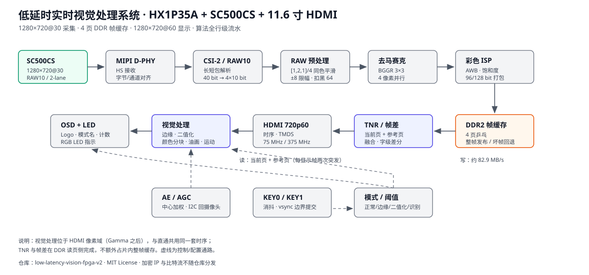

# 02 · 算法流水线

按“基础 / 扩展 / 进阶”三层看。每一层都只回答：**用什么算法、在哪一级、延迟多少**。

## 基础层

### 采集与解包

| 级 | 模块 | 输入 → 输出 | 节拍 |
|---|---|---|---|
| 1 | D-PHY 硬核 | 2-lane 差分 → 字节流 | 恢复时钟域 |
| 2 | `csi_unpacket_2lane` | 字节流 → 帧起止、负载 | 按包解析 |
| 3 | `raw10_unpacket_2lane` | 40 bit → 4×10 bit | 每拍 4 像素 |
| 4 | `uial2axis` | 像素 + 帧/行标志 | 1 拍 |
| 5 | 异步 FIFO | 采集域 → DDR 域 | 128 bit × 512 |

### RAW 预处理

```text
out = round_even((a + 2c + b) / 4)   仅当 |a−c| ≤ 8 且 |b−c| ≤ 8
扣黑：out = max(raw − 64, 0)
```

四个像素并行、1 拍完成；不引入行缓冲。`raw_spatial_edge` 处理同色三点，`raw_fixed_blc64` 扣黑。

### 去马赛克

BGGR 排列，3×3 双线性：G 由上下左右平均，R/B 由同行/同列或对角平均补齐。`mhc_stream4` 把 4 像素
并行流拆成 4 个相位，`mhc_kernel4` 做 3×3 窗口，`mhc_pixel` 按像素位置选择插值公式。4 路并行意味着
每拍仍处理 4 个像素，不需要把像素时钟提高 4 倍。

### 边缘检测（Canny 变体）

| 级 | 模块 | 功能 | 延迟 |
|---|---|---|---|
| 1 | `rgb2gray` / `rgb2chroma` | Y、C=R−B 打包 | 1 拍 |
| 2 | 中值 #1 | 3×3 去噪 | 3 拍 |
| 3 | 中值 #2 | 替代高斯 | 3 拍 |
| 4 | `sobel_edge` | Gx、Gy、L1 幅值 | 1 拍 |
| 5 | NMS + 方向一致性 | 单像素细化 | 1 拍 + 1 行 |
| 6 | 双阈值 + 滞后连接 | 7×7 弱边连通（`HYST_STAGES=3`） | 3 行 |
| 7 | 邻域/桥接/闭运算 | 修断线、去孤立点 | 2 行 |
| 8 | 输出寄存 | 与彩色路径对齐 | 1 拍 |

亮度通道和色差通道各做一遍 Sobel，取幅值更大的那个；这样红绿边界、蓝黄边界不会因为亮度接近而丢失。
最长约 10 行 + 29 拍。

### 3×3 窗口与中值

- 窗口每右移一格，只丢最左一列、读入最右一列，所以只需两行历史；
- 中值用比较器网络（19 个比较器），不是排序表；
- Sobel 的乘 2 用移位，幅值用 L1（`|Gx|+|Gy|`）；
- 方向判决用 `5·ax ≤ 2·ay` / `5·ay ≤ 2·ax` 两个比例，避免除法。

### 二值化

- 每帧统计 256 bin 灰度直方图；
- 用迭代类均值（Intermeans）求双峰谷底：`T = (μ_lo + μ_hi)/2`；
- IIR 每帧靠拢 1/4、死区 2、限幅 `[24, 232]`、亮度偏置 `BIN_BIAS=80` 偏向暗类；
- 判决：`gray >= T` 判白，否则判黑；
- 顶层 `BIN_LOCAL_EN=0`、`BIN_MAJORITY_EN=0`：使用帧级全局阈值，避免同一色块内判决翻转。

### OSD

- 安路 Logo：146×94 @ (12,12)，位图 ROM，透明叠加；
- 中文模式名：左下角 100×27 区域，4 个 24 像素字格，模式 0~5 各一句；
- 运动计数：右上角 `COUNT:` 标题 + 4 位十进制数字；
- 中心十字与活动区着色：由 `motion_alarm_osd` 直接绘制，不查外部字库。

## 扩展层

### 视频油画

`oil_pixel5` 对当前像素的 5×5 邻域做“量化 + 投票 + 桶内平均”：

1. 每个通道先量化到 4 bit（取高 4 位），得到 `(R4,G4,B4)`；
2. 亮度 `lum = R4 + 2·G4 + B4`，取 `lum[5:4]` 作为 4 个亮度桶之一；
3. 统计 25 个像素落在 4 个桶里的数量，选最多的桶；
4. 对该桶内的像素求 R/G/B 平均（用移位减法的近似除法，不占 DSP）；
5. 输出 4 bit/通道，再复制高低半字节扩展成 8 bit。

效果是“颜色被压成少数几档、边缘保留块状”，比双边滤波更适合 FPGA。画面四周 `BORDER+4` 圈不处理，
避免行缓冲没填满时出现黑边。

### 色彩分块



| 级 | 功能 | 工作量 |
|---|---|---|
| 1 | RGB 三色判决（弱/强两级） | 每像素约 10 次比较 |
| 2 | 3×3 空间核心投票 | 红/绿弱目标至少 5/9 票 |
| 3 | 行行程 | 逐像素计数 |
| 4 | 双候选包围盒 | 每色 2 个候选，合并/淘汰 |
| 5 | 帧界跟踪 | 距离 + 尺寸代价匹配 |
| 6 | 平滑与保持 | 死区 8、每帧限幅 24、丢失保持 3 帧 |
| 7 | 框与标签 | 1 拍查表 |

判决条件：

- 红：`R > G+40 且 R > B+40 且 R > 60`；
- 绿：`G ≥ R+20 且 G ≥ B+20 且 G ≥ 36`；强绿再要求 `G ≥ R+24、G ≥ B+24、G ≥ 44`；
- 蓝：先算亮度 `y=(R+2G+B)/4`、饱和度 `sat=max−min`，弱目标要求 `y≥16、sat≥8、sat≥max/8`，
  且 `B > R+max(max/4,10)`、`B > G+同值`；强目标再要求 `y≥20、sat≥16、sat≥max/4`，
  且 `B > R+max(max/4+max/8,12)`。

每种颜色最多保留 2 个候选框，绿色只保留 1 个（`single_green`），因此最多同时显示 5 个框。
同色多目标合并为外接矩形；形状分类未实现，`O_shape` 固定为 `12'hfff`。

### 帧差运动检测

帧差不在 `video_out_tnr` 里额外存图，而是复用“当前页 / 参考页”两条 DDR 读流：

1. 每读一个 128 bit 字，与参考页同地址的字逐字节比较；
2. 16 个通道中有 ≥6 个通道的绝对差 >16，记为 `hot`；
3. 连续 2 个字都 `hot` 才形成“支持”（`streak≥2`），抑制单字噪声；
4. 同一行内左右支持区间相距 ≤8 像素则配成一段，相邻行再配成包围盒；
5. 一帧内 `hot_words` 在 `[24, FRAME_WORDS/4]`、框至少 16×6 才判为有效运动；
6. 目标框覆盖画面中心 (640,360) 时，若此前“离开中心 4 帧”已 armed，则计数 +1；
7. 活动区叠一层暖色 tint，中心画白色十字，右上角显示 4 位十进制计数。

计数只在“色彩识别 → 帧差运动”子模式下工作；切走时计数保持，切回后继续。

### 时域降噪（TNR）

`video_out_tnr` 在显示读页时同时读当前页与参考页（page+1）：

- 逐通道差 ≤ `DIFF_MAX=8` 视为相似，做 `(current + reference)/2`；
- 差异大的通道保留当前值，避免把运动拖成残影；
- `TNR_EN=1` 时启用；置 0 则只做旁路延迟对齐，方便 A/B 对比；
- 参考页不参与显示，只增加 DDR 读带宽（见 05 的带宽计算）。

## 进阶层

### AWB：一个除法器两相串行

- 帧统计 R/G/B 累加值；
- `tuser` 拍锁存影子寄存器（清零前的旧值）；
- 四态机：IDLE → ARM → R（G/R，50 拍）→ B（G/B，50 拍）→ IDLE；
- 商 Q16，限幅 0.5~4×，死区 1.6%，1/4 平滑，帧边界提交。

### AE/AGC：中心加权、曝光优先

- 中心 1/2×1/2 权重 4，其余权重 1；
- 目标亮度 130；先加曝光（上限 3980 半行），不够再加模拟增益（上限 112，约 8×）；
- 高亮 200/224/240 三档保护；
- 每 8 个显示帧调整一次。

### 自动阈值

- 边缘：NMS 幅值直方图分位点 + 噪声上四分位 ×2 作为下限；
- 局部窗口 64 列，当地噪声低时最多放宽到全局阈值的一半；
- 二值化：帧级全局阈值，保证同一色块内判决一致。

下一篇：[03 · 核心代码解读](03_核心代码解读.md)
